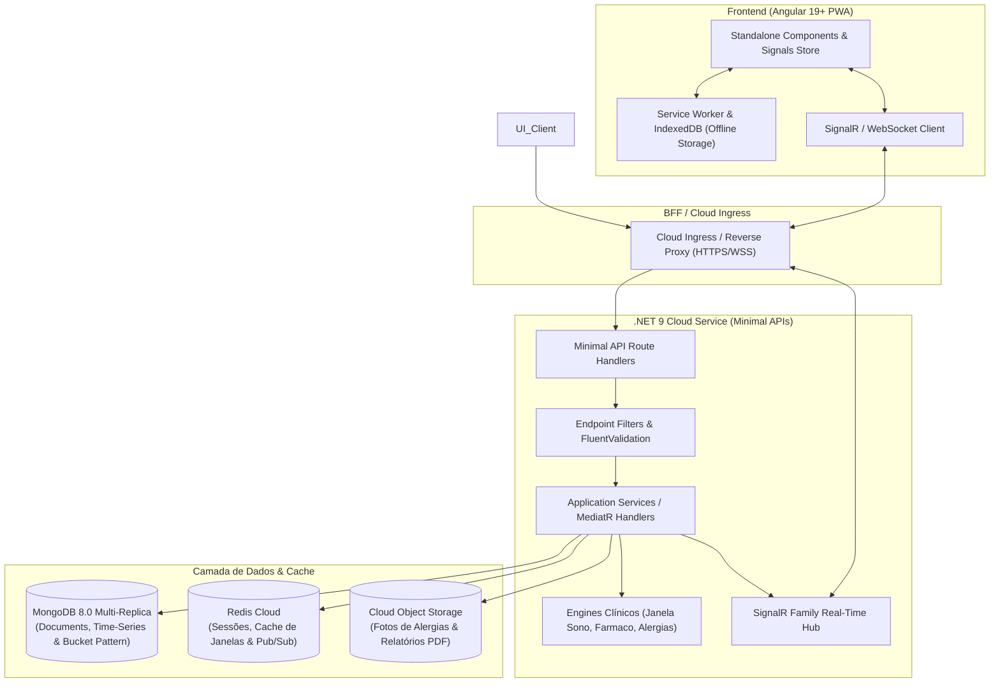
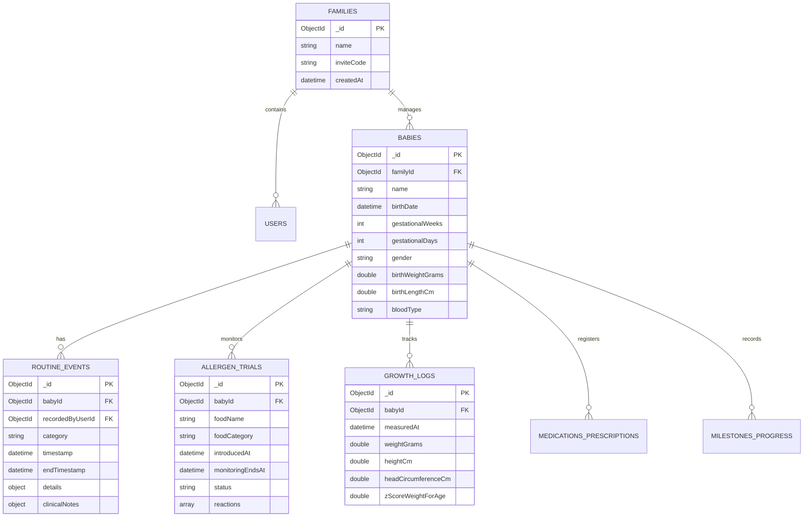
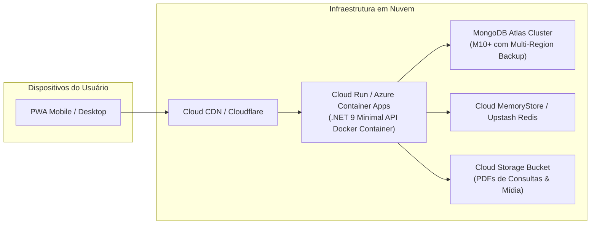

# Documento de Arquitetura e Design de Software (Design Doc)
# Sistema de Gestão da Rotina do Bebê (0 a 24 Meses)

**Versão:** 1.0.0  
**Status:** Aprovado para Desenvolvimento  
**Data:** 17 de Outubro de 2026  
**Stack Principal:** .NET 9 (Minimal APIs) | Angular 19+ (Signals, Standalone, PWA) | MongoDB 8.0  
**Documento Base de Negócio:** [rotinas_de_beb_s_at_2_anos_guia_completo.md](file:///c:/Users/eduar/Documents/git/rotina-do-bebe/rotinas_de_beb_s_at_2_anos_guia_completo.md)

---

## Sumário Executivo

O presente documento de design detalha a arquitetura completa, modelo de dados, engenharia de back-end, design de interface e plano de entrega do **Sistema de Gestão da Rotina do Bebê (0 a 24 Meses)**. 

A aplicação tem como premissa fundacional o princípio do **Registro de Fricção Mínima**: permitir que cuidadores em estado de privação de sono registrem eventos cruciais de saúde, sono, alimentação e desenvolvimento em no máximo **1 a 2 toques**, ao mesmo tempo em que fornece inteligência preditiva (como o cálculo da janela de vigília e alertas clínicos pediátricos em tempo real).

---

## 1. Visão Geral do Produto e Princípios de Design

### 1.1 Missão e Filosofia do Sistema
Cuidar de um lactente exige vigilância contínua. Formulários complexos, campos de texto obrigatórios e telas lentas provocam abandono de uso justamente nos momentos de maior vulnerabilidade familiar (madrugadas, crises de febre, introdução de novos alérgenos).

O sistema resolve essa dor através de 4 pilares:
1. **Entrada Ultrarrápida (Quick-Log 1-Tap):** Ícones grandes, códigos padronizados (`U` Urina, `E` Evacuação, `M` Mista, `L` Limpa) e timers integrados de um toque.
2. **Design Noturno Biológico (Modo Madrugada):** Interface adaptativa com paleta escura (True Black `#0A0B0E`), baixíssima emissão de luz azul e contraste otimizado para não despertar o bebê nem ofuscar o cuidador.
3. **Inteligência Clínica e Preditiva:** Motores algorítmicos que calculam a próxima janela de sono ideal, alertam intervalos de dosagem de antitérmicos e detectam sinais de alerta nas fraldas (como acolia fecal ou sangue vivo).
4. **Colaboração Familiar Multiusuário:** Sincronização em tempo real entre mãe, pai, avós, babás e pediatra via WebSockets/SSE.

### 1.2 Personas do Sistema
* **Cuidador Principal (Mãe/Pai):** Precisa registrar rapidamente mamadas, fraldas e sonecas com apenas uma das mãos enquanto amamenta ou ninam o bebê.
* **Rede de Apoio (Babás/Avós):** Necessitam de interface intuitiva com permissões bem delimitadas para consultar horários de remédios e registrar mamadeiras e fraldas.
* **Pediatra:** Acessa uma visualização analítica consolidada (relatório PDF ou link seguro temporário) com curvas de crescimento OMS, histórico de febre, aceitação na introdução alimentar e regularidade intestinal.

---

## 2. Arquitetura Geral do Sistema

A aplicação adota uma arquitetura em camadas orientada a serviços leves, desacoplada e otimizada para nuvem (Cloud-Native), com suporte a funcionamento Offline-First no dispositivo do usuário.



### 2.1 Visão dos Componentes
* **Client Frontend (Angular 19+):** Single Page Application com capacidades de PWA (Progressive Web App). Utiliza Signals nativos para reatividade fina sem sobrecarga de renderização, Tailwind/Vanilla CSS sob Design Tokens e armazenamento local em IndexedDB para registro offline com sincronização automática em background.
* **Back-End API (.NET 9 Minimal APIs):** Microsserviço de alta performance, sem overhead de controladores tradicionais, estruturado segundo o padrão **Vertical Slice Architecture** (fatias verticais organizadas por casos de uso).
* **Banco de Dados (MongoDB 8.0):** Modelo NoSQL orientado a documentos JSON polimórficos, permitindo flexibilidade para registrar eventos de naturezas distintas (mamada, sono, medicação, marcos) sob uma mesma coleção otimizada com índices compostos.
* **Tempo Real (SignalR Hub):** Notificação instantânea entre os dispositivos da mesma família (ex: quando o pai registra uma troca de fralda, a tela da mãe é atualizada imediatamente sem refresh).

---

## 3. Modelo de Dados (MongoDB Data Modeling)

Para maximizar a performance de leitura (necessária para os dashboards de tendências e cálculo de janelas) e a velocidade de escrita de eventos rápidos, as coleções foram modeladas com granularidade híbrida (Embedded + Referenced Documents).



### 3.1 Definições dos Schemas (BSON / C# DTOs)

#### 3.1.1 Coleção `families` e `users`
Implementa o suporte multitenancy e controle de acesso baseado em papéis (RBAC):
* Papéis: `Owner` (Pais administradores), `Caregiver` (Babás, avós com escrita de rotina), `Medical` (Acesso somente-leitura ou temporário para o pediatra).

```json
// Documento: families
{
  "_id": ObjectId("65f1a1000000000000000001"),
  "name": "Família Silva",
  "subscriptionTier": "FamilyPro",
  "members": [
    {
      "userId": ObjectId("65f1a2000000000000000001"),
      "role": "Owner",
      "relation": "Mãe",
      "notificationPreferences": { "pushEnabled": true, "nightModeAlerts": false }
    },
    {
      "userId": ObjectId("65f1a2000000000000000002"),
      "role": "Caregiver",
      "relation": "Babá",
      "notificationPreferences": { "pushEnabled": true, "nightModeAlerts": false }
    }
  ],
  "createdAt": ISODate("2026-03-01T10:00:00Z")
}
```

#### 3.1.2 Coleção `babies`
Suporta cálculo de idade cronológica e **idade corrigida** (fundamental para bebês prematuros nascidos com menos de 37 semanas gestacionais na avaliação dos marcos motores e curvas OMS).

```json
// Documento: babies
{
  "_id": ObjectId("65f1b1000000000000000001"),
  "familyId": ObjectId("65f1a1000000000000000001"),
  "name": "Lucas Silva",
  "birthDate": ISODate("2026-01-15T08:30:00Z"),
  "gestationalWeeks": 36,
  "gestationalDays": 4,
  "gender": "M",
  "birthWeightGrams": 2750,
  "birthLengthCm": 47.5,
  "currentWeightGrams": 5800,
  "bloodType": "O+",
  "pediatrician": {
    "name": "Dra. Mariana Costa",
    "crm": "123456-SP",
    "emergencyPhone": "+5511999998888"
  },
  "activeMedications": [
    {
      "name": "Vitamina D3",
      "dose": "2 gotas (400 UI)",
      "frequency": "Diária às 08:00",
      "isContinuous": true
    },
    {
      "name": "Sulfato Ferroso",
      "dose": "1 mg/kg/dia",
      "frequency": "Diária às 11:30",
      "isContinuous": true
    }
  ],
  "allergies": ["Amendoim - Suspeita em investigação"],
  "createdAt": ISODate("2026-01-15T09:00:00Z")
}
```

#### 3.1.3 Coleção Central Polimórfica: `routine_events`
Cada evento diário (alimentação, fralda, sono, medicação, banho) é salvo como um documento padronizado, onde o campo `details` é tipado de acordo com a `category`.

```json
// Exemplo 1: Evento de Fralda (Codificação Rápida Seção 4)
{
  "_id": ObjectId("65f1c1000000000000000001"),
  "babyId": ObjectId("65f1b1000000000000000001"),
  "recordedByUserId": ObjectId("65f1a2000000000000000001"),
  "category": "Diaper",
  "timestamp": ISODate("2026-04-10T10:15:00Z"),
  "details": {
    "state": "M", // L = Limpa, U = Urina, E = Evacuação, M = Mista
    "volumeLevel": 2, // 1 = Baixo, 2 = Médio, 3 = Alto
    "stoolConsistency": "LiquidPastous", // LiquidPastous, MoldedPastous, Hardened
    "stoolColor": "Mustard", // Mustard, BrownishGreen, WhiteGrey (Alerta!), Black (Alerta!), RedBlood (Alerta!)
    "hasMucus": false,
    "hasBlood": false,
    "barrierCreamApplied": true
  },
  "clinicalFlags": {
    "isRedFlagAlert": false,
    "alertMessage": null
  },
  "notes": "Pele íntegra, sem dermatite."
}

// Exemplo 2: Evento de Sono (Fisiologia e Janela de Vigília Seção 3)
{
  "_id": ObjectId("65f1c1000000000000000002"),
  "babyId": ObjectId("65f1b1000000000000000001"),
  "category": "Sleep",
  "timestamp": ISODate("2026-04-10T13:30:00Z"),
  "endTimestamp": ISODate("2026-04-10T15:00:00Z"),
  "durationMinutes": 90,
  "details": {
    "sleepType": "Nap", // Nap (Soneca diurna), NightSleep (Sono noturno)
    "wakeWindowPrecedingMinutes": 210, // 3h30 acordado antes de dormir
    "sleepLocation": "Crib", // Crib (Berço), Lap (Colo), Stroller (Carrinho), CoSleeping (Cama)
    "fallingAsleepMethod": "WhiteNoiseAndRocking",
    "sleepQuality": "Good", // Restless, Good, Interrupted
    "awakeningsCount": 0,
    "reinductionMethods": []
  },
  "notes": "Transição de soneca tranquila, quarto com blackout."
}

// Exemplo 3: Evento de Nutrição / Amamentação (Seção 2)
{
  "_id": ObjectId("65f1c1000000000000000003"),
  "babyId": ObjectId("65f1b1000000000000000001"),
  "category": "Feeding",
  "timestamp": ISODate("2026-04-10T12:00:00Z"),
  "endTimestamp": ISODate("2026-04-10T12:35:00Z"),
  "details": {
    "feedingType": "Solids", // Breast, Formula, ExpressedMilk, Solids
    "breastfeedingDetails": null,
    "solidsDetails": {
      "mealType": "Lunch", // Breakfast, MorningSnack, Lunch, AfternoonSnack, Dinner
      "foodGroups": {
        "fruitsAndVegetables": ["Abóbora", "Cenoura"],
        "cerealsAndTubers": ["Arroz integral"],
        "legumes": ["Feijão carioca"],
        "animalProtein": ["Patinho bovino moído"]
      },
      "acceptanceLevel": "High", // Refused, Low, Medium, High
      "allergensPresented": [],
      "eatingAutonomy": "BLW_Assisted", // PureeSpoon, BLW, Mixed
      "hungerCuesNoticed": "SmackingLipsAndHandsInMouth",
      "satietyCuesNoticed": "HeadTurningAndClosedLips"
    }
  },
  "notes": "Excelente aceitação das leguminosas e da abóbora."
}

// Exemplo 4: Evento de Medicação Aguda (Seção 1.2)
{
  "_id": ObjectId("65f1c1000000000000000004"),
  "babyId": ObjectId("65f1b1000000000000000001"),
  "category": "Medication",
  "timestamp": ISODate("2026-04-10T03:15:00Z"),
  "details": {
    "medicationName": "Paracetamol Gotas (200mg/mL)",
    "dosageGiven": "12 gotas",
    "dosageMg": 120,
    "babyWeightAtTimeKg": 6.0,
    "reason": "Febre de 38.3°C pós-vacina",
    "measuredTemperatureCelsius": 38.3,
    "minimumIntervalHours": 6,
    "nextAllowedDoseAt": ISODate("2026-04-10T09:15:00Z")
  },
  "notes": "Febre iniciou 6h após vacina pentavalente."
}
```

#### 3.1.4 Coleção `allergen_trials` (Rastreamento de Introdução de Alérgenos)
Controla a regra de ouro descrita na Seção 2.2 do guia (1 novo alimento alérgeno por vez com monitoramento ativo durante 48 a 72 horas).

```json
// Documento: allergen_trials
{
  "_id": ObjectId("65f1d1000000000000000001"),
  "babyId": ObjectId("65f1b1000000000000000001"),
  "foodName": "Ovo Cozido (Gema e Clara)",
  "foodCategory": "Proteínas Animais / Alérgeno Principal",
  "introducedAt": ISODate("2026-04-08T11:30:00Z"),
  "monitoringEndsAt": ISODate("2026-04-11T11:30:00Z"), // Janela de 72 horas
  "status": "SafeCompleted", // MonitoringActive, ReactionReported, SafeCompleted
  "exposureDoses": [
    { "day": 1, "quantityOffered": "1/4 colher de chá", "reactionObserved": false },
    { "day": 2, "quantityOffered": "1/2 colher de chá", "reactionObserved": false },
    { "day": 3, "quantityOffered": "1 colher de sobremesa", "reactionObserved": false }
  ],
  "symptomsChecklist": {
    "hivesOrRash": false,
    "facialSwelling": false,
    "acuteVomiting": false,
    "explosiveDiarrhea": false,
    "wheezing": false
  },
  "pediatricianNotes": "Alimento liberado para compor o cardápio rotineiro."
}
```

#### 3.1.5 Coleção `milestones_progress` (Marcos do Desenvolvimento Motor)
Contempla toda a linha do tempo motora (cefalocaudal e próximo-distal) detalhada na Seção 5 do guia:

```json
// Documento: milestones_progress
{
  "_id": ObjectId("65f1e1000000000000000001"),
  "babyId": ObjectId("65f1b1000000000000000001"),
  "milestoneCode": "MOTOR_06M_SITTING",
  "title": "Sentar com apoio mínimo",
  "directionType": "Cephalocaudal", // Cephalocaudal, Proximodistal
  "expectedAgeMonths": 6,
  "status": "Achieved", // NotStarted, InProgress, Achieved
  "achievedAtDate": ISODate("2026-04-05T00:00:00Z"),
  "actualAgeAtAchievementDays": 172,
  "mediaPhotoUrl": "https://storage.rotinadobebe.com/media/lucas_sentando.jpg",
  "notes": "Conseguiu ficar sentado no tapetinho sem tombar para os lados."
}
```

### 3.2 Estratégia de Índices MongoDB
Para garantir respostas de sub-10 milissegundos nas queries da timeline diária e análises históricas:

```javascript
// 1. Índice Composto para a Timeline Diária (Query mais frequente do App)
db.routine_events.createIndex(
  { babyId: 1, timestamp: -1 },
  { name: "idx_routine_baby_timestamp_desc" }
);

// 2. Índice Composto para Filtro por Categoria e Intervalo de Datas
db.routine_events.createIndex(
  { babyId: 1, category: 1, timestamp: -1 },
  { name: "idx_routine_baby_category_timestamp" }
);

// 3. Índice para Verificação Ativa de Medicações Agudas
db.routine_events.createIndex(
  { babyId: 1, "details.nextAllowedDoseAt": 1 },
  { name: "idx_routine_baby_medication_interval" }
);

// 4. Índice para Alérgenos em Monitoramento Ativo (Janela de 72h)
db.allergen_trials.createIndex(
  { babyId: 1, status: 1, monitoringEndsAt: 1 },
  { name: "idx_allergen_baby_status_monitoring" }
);
```

---

## 4. Arquitetura e Especificação do Back-End (.NET 9 Minimal API)

O back-end é implementado em **C# / .NET 9** utilizando **Minimal APIs** estruturadas em fatias verticais (*Vertical Slice Architecture*), garantindo baixa alocação de memória, inicialização quase instantânea em containers de nuvem (Cold Start < 200ms) e alta clareza de testes.

### 4.1 Estrutura de Diretórios do Projeto Back-End

```text
src/Backend/
├── BabyRoutine.Api/
│   ├── Program.cs                         # Bootstrapper das Minimal APIs e Injeção de Dependências
│   ├── appsettings.json                   # Configurações de conexão, JWT e Logging
│   ├── Extensions/
│   │   ├── EndpointRouteBuilderExtensions.cs # Mapeamento automático de rotas
│   │   └── OpenTelemetryExtensions.cs        # Tracing e métricas para Cloud
│   ├── Filters/
│   │   └── ValidationFilter.cs            # Validação unificada via FluentValidation
│   └── Hubs/
│       └── FamilyHub.cs                   # SignalR para sincronização familiar em tempo real
├── BabyRoutine.Application/
│   ├── Common/
│   │   ├── Interfaces/
│   │   └── Models/
│   ├── Features/
│   │   ├── RoutineEvents/
│   │   │   ├── CreateEvent/
│   │   │   │   ├── CreateEventEndpoint.cs  # POST /api/babies/{id}/events
│   │   │   │   ├── CreateEventCommand.cs
│   │   │   │   └── CreateEventValidator.cs
│   │   │   ├── GetDailyTimeline/
│   │   │   │   ├── GetDailyTimelineEndpoint.cs # GET /api/babies/{id}/timeline/{date}
│   │   │   │   └── GetDailyTimelineQuery.cs
│   │   ├── Sleep/
│   │   │   ├── CalculateWakeWindow/        # Cálculo dinâmico da janela de vigília
│   │   │   └── DetectNapTransition/        # Alerta de transição de soneca (Seção 6.1)
│   │   ├── Feeding/
│   │   │   ├── RegisterAllergenTrial/      # Monitoramento 72h de alérgenos
│   │   │   └── GetHungerSatietyGuide/      # Guias de sinais biológicos de fome/saciedade
│   │   ├── Diapers/
│   │   │   ├── QuickDiaperLog/             # Registro rápido U/E/M/L
│   │   │   └── CheckClinicalStoolFlags/    # Detecção de acolia, sangue ou melena
│   │   ├── Health/
│   │   │   ├── CheckMedicationSafety/      # Validador de dosagem por kg e intervalo
│   │   │   └── VaccinesCalendar/           # Calendário vacinal 0-2 anos
│   │   └── Milestones/
│   │       ├── GetMotorTimeline/           # Linha do tempo cefalocaudal/próximo-distal
│   │       └── ToggleMilestoneAchievement/
│   └── Engines/
│       ├── WakeWindowEngine.cs            # Motor matemático de sono infantil
│       ├── MedicationIntervalEngine.cs    # Motor farmacológico de segurança
│       └── PediatricReportEngine.cs       # Gerador do consolidado médico
└── BabyRoutine.Infrastructure/
    ├── Persistence/
    │   ├── MongoDbContext.cs
    │   └── Repositories/
    ├── Services/
    └── BackgroundJobs/
        └── MedicationReminderJob.cs       # Disparador de lembretes e alarmes
```

### 4.2 Motores Clínicos e Algorítmicos Centrais

#### 4.2.1 Motor de Janelas de Vigília (`WakeWindowEngine.cs`)
Conforme exposto nas Seções 3.1 e 6.1 do guia de negócios, bebês possuem uma tolerância máxima ao estado desperto antes que o cortisol se eleve excessivamente. O motor calcula:
1. Tempo decorrido desde o último despertar.
2. Faixa ideal de vigília baseada na idade (cronológica ou corrigida).
3. Previsão do horário ótimo do próximo adormecimento (*Sweet Spot* de sono).
4. Alerta de prontidão para transição de sonecas se houver resistência por mais de 7 a 10 dias consecutivos.

```csharp
public class WakeWindowEngine
{
    public record WakeWindowRange(TimeSpan Min, TimeSpan Max, int ExpectedNaps);

    public static WakeWindowRange GetFisiologicalRange(int ageInMonths) => ageInMonths switch
    {
        0 => new(TimeSpan.FromMinutes(45), TimeSpan.FromMinutes(60), ExpectedNaps: 5), // 0-1m
        1 => new(TimeSpan.FromMinutes(60), TimeSpan.FromMinutes(90), ExpectedNaps: 4), // 1-2m
        2 or 3 => new(TimeSpan.FromMinutes(75), TimeSpan.FromMinutes(120), ExpectedNaps: 4), // 3-4m
        4 or 5 => new(TimeSpan.FromMinutes(90), TimeSpan.FromMinutes(150), ExpectedNaps: 3), // Transição 4->3
        6 or 7 or 8 => new(TimeSpan.FromMinutes(120), TimeSpan.FromMinutes(180), ExpectedNaps: 2), // Transição 3->2
        >= 9 and <= 14 => new(TimeSpan.FromMinutes(180), TimeSpan.FromMinutes(240), ExpectedNaps: 2),
        >= 15 and <= 24 => new(TimeSpan.FromMinutes(240), TimeSpan.FromMinutes(360), ExpectedNaps: 1), // Transição 2->1
        _ => new(TimeSpan.FromMinutes(300), TimeSpan.FromMinutes(420), ExpectedNaps: 1)
    };

    public WakeWindowStatus CalculateStatus(DateTime lastWakeTime, int ageInMonths)
    {
        var now = DateTime.UtcNow;
        var awakeDuration = now - lastWakeTime;
        var range = GetFisiologicalRange(ageInMonths);

        var idealSleepStart = lastWakeTime + range.Min;
        var maximumSleepStart = lastWakeTime + range.Max;

        if (awakeDuration < range.Min)
        {
            return new WakeWindowStatus(
                AwakeDuration: awakeDuration,
                State: "Bebê Tranquilo / Período de Brincadeiras",
                AlertLevel: "Normal",
                IdealSleepTime: idealSleepStart,
                RemainingMinutesToSweetSpot: (int)(idealSleepStart - now).TotalMinutes
            );
        }
        else if (awakeDuration >= range.Min && awakeDuration <= range.Max)
        {
            return new WakeWindowStatus(
                AwakeDuration: awakeDuration,
                State: "Sweet Spot: Momento Ideal para Ritual de Sono",
                AlertLevel: "Optimal",
                IdealSleepTime: now,
                RemainingMinutesToSweetSpot: 0
            );
        }
        else
        {
            return new WakeWindowStatus(
                AwakeDuration: awakeDuration,
                State: "Alerta de Janela Ultrapassada: Risco de Cortisol Alto e Choro",
                AlertLevel: "Overdue",
                IdealSleepTime: maximumSleepStart,
                RemainingMinutesToSweetSpot: 0
            );
        }
    }
}

public record WakeWindowStatus(
    TimeSpan AwakeDuration,
    string State,
    string AlertLevel,
    DateTime IdealSleepTime,
    int RemainingMinutesToSweetSpot
);
```

#### 4.2.2 Motor de Segurança Medicamentosa (`MedicationSafetyEngine.cs`)
Impede erros fatais de superdosagem de antitérmicos e analgésicos durante madrugadas caóticas:
1. Bloqueia registros de doses antes do intervalo de segurança mínimo (ex: Paracetamol < 6h).
2. Valida se a dosagem em mg informada é compatível com o peso atual do bebê cadastrado no sistema.

```csharp
public class MedicationSafetyEngine
{
    public record MedicationSafetyResult(bool IsSafe, string Message, DateTime? NextAllowedDose);

    public static MedicationSafetyResult ValidateDose(
        string medicationName,
        double babyWeightKg,
        double doseMg,
        DateTime requestedDoseTime,
        DateTime? lastDoseTime)
    {
        // 1. Verificação de Intervalo Mínimo
        var minInterval = medicationName.ToLower().Contains("ibuprofeno") 
            ? TimeSpan.FromHours(8) 
            : TimeSpan.FromHours(6); // Paracetamol ou Dipirona

        if (lastDoseTime.HasValue)
        {
            var nextAllowed = lastDoseTime.Value + minInterval;
            if (requestedDoseTime < nextAllowed)
            {
                var remaining = nextAllowed - requestedDoseTime;
                return new(false, 
                    $"INTERVALO INSUFICIENTE! Última dose há {(int)(requestedDoseTime - lastDoseTime.Value).TotalMinutes} min. Próxima dose permitida em {(int)remaining.TotalMinutes} minutos.",
                    nextAllowed);
            }
        }

        // 2. Validação de Dosagem por Quilo (Exemplo: Paracetamol max 15mg/kg/dose)
        var maxRecommendedMg = babyWeightKg * 15.0;
        if (doseMg > maxRecommendedMg * 1.1) // 10% tolerância
        {
            return new(false, 
                $"ALERTA DE SEGURANÇA: Dose ({doseMg}mg) excede o limite seguro ({maxRecommendedMg:F1}mg) para o peso de {babyWeightKg}kg.",
                null);
        }

        return new(true, "Dosagem e intervalo validados com sucesso.", requestedDoseTime + minInterval);
    }
}
```

#### 4.2.3 Motor de Triagem Pediátrica de Fezes (`PediatricStoolClassifier.cs`)
Conforme a Seção 4.1 do documento base, analisa cores e consistências de fezes:
* **Vermelho Vivo / Sangue:** Alerta Imediato de Suspeita de APLV (Alergia à Proteína do Leite de Vaca) ou fissura anal.
* **Branco / Acinzentado (Acolia Fecal):** Alerta Clínico de Emergência (Suspeita de atresia de vias biliares ou colestase neonatal).
* **Preto / Melena:** Alerta Clínico de Emergência (Sangramento gastrointestinal alto).

```csharp
public class PediatricStoolClassifier
{
    public static (bool IsClinicalAlert, string? AlertMessage, string UrgencyLevel) Evaluate(
        string color, 
        string consistency, 
        bool hasBlood, 
        int babyAgeDays)
    {
        if (color.Equals("WhiteGrey", StringComparison.OrdinalIgnoreCase))
        {
            return (true, "EMERGÊNCIA PEDIÁTRICA: Fezes brancas/acinzentadas (acolia fecal). Procure o pronto-atendimento para investigar vias biliares.", "Emergency");
        }

        if (color.Equals("Black", StringComparison.OrdinalIgnoreCase) && babyAgeDays > 5) // mecônio nos primeiros 3-5 dias é fisiológico
        {
            return (true, "ALERTA URGENTE: Fezes pretas (melena) após o período neonatal podem indicar sangramento digestivo.", "Urgent");
        }

        if (hasBlood || color.Equals("RedBlood", StringComparison.OrdinalIgnoreCase))
        {
            return (true, "AVISO PEDIÁTRICO: Presença de sangue vivo nas fezes. Fotografe e consulte o pediatra para investigar APLV ou fissuras.", "HighPriority");
        }

        return (false, null, "Normal");
    }
}
```

### 4.3 Especificação dos Endpoints REST (.NET Minimal APIs)

Todas as rotas são organizadas sob `app.MapGroup("/api/babies/{babyId}")` com autenticação JWT e filtros de validação automática:

| Método | Endpoint | Descrição Clínica / Funcional | Payload Principal |
| :--- | :--- | :--- | :--- |
| `POST` | `/api/babies/{id}/events` | Registro genérico ou rápido de qualquer evento de rotina | `CreateRoutineEventDto` |
| `GET` | `/api/babies/{id}/timeline/{date}` | Resumo cronológico do dia (Ficha da Seção 7) | Retorna lista ordenada de eventos + estatísticas |
| `GET` | `/api/babies/{id}/sleep/wake-window` | Consulta o status da janela de vigília e predição de soneca | Retorna `WakeWindowStatus` em tempo real |
| `GET` | `/api/babies/{id}/sleep/transition-readiness` | Avalia resistência a sonecas nos últimos 7 a 10 dias | Retorna métricas de transição (ex: 3 para 2 sonecas) |
| `POST` | `/api/babies/{id}/feeding/quick-breast` | Registro de 1 toque de amamentação (lado + duração) | `{ side: "L"\|"R", durationSeconds: 900 }` |
| `POST` | `/api/babies/{id}/feeding/solids-plate` | Registro dos 4 grupos de introdução alimentar (Seção 2.2) | `{ fruits: [...], cereals: [...], legumes: [...], protein: [...] }` |
| `POST` | `/api/babies/{id}/feeding/allergen-trial` | Inicia protocolo de 72h de introdução de novo alérgeno | `{ foodName: "Ovo", foodGroup: "Proteína" }` |
| `POST` | `/api/babies/{id}/diapers/quick` | Registro relâmpago de fralda codificada (`U1`, `M2`, `E3`) | `{ code: "M2", stoolColor: "Mustard", consistency: "Pastous" }` |
| `POST` | `/api/babies/{id}/medications/administer` | Administra medicação com validação de segurança | `{ medicationName: "Paracetamol", doseMg: 120, temp: 38.2 }` |
| `GET` | `/api/babies/{id}/milestones` | Checklist de marcos motores por idade (Seção 5) | Retorna status de marcos (alcançado, em progresso) |
| `GET` | `/api/babies/{id}/reports/pediatric-summary` | Gera relatório estruturado para a consulta pediátrica | Retorna JSON consolidado ou URL de PDF exportável |

#### Exemplo de Implementação de Endpoint Minimal API:
```csharp
public static class RoutineEndpoints
{
    public static RouteGroupBuilder MapRoutineEndpoints(this RouteGroupBuilder group)
    {
        group.MapPost("/events", async (
            string babyId,
            CreateRoutineEventDto dto,
            IRoutineEventRepository repo,
            IHubContext<FamilyHub> hub,
            ClaimsPrincipal user,
            CancellationToken ct) =>
        {
            var eventDoc = dto.ToDomain(babyId, user.GetUserId());
            
            // Verificação de Alertas Clínicos Automáticos
            if (eventDoc.Category == RoutineCategory.Diaper)
            {
                var flags = PediatricStoolClassifier.Evaluate(
                    eventDoc.Details.StoolColor,
                    eventDoc.Details.StoolConsistency,
                    eventDoc.Details.HasBlood,
                    eventDoc.BabyAgeDays
                );
                eventDoc.ClinicalFlags = new(flags.IsClinicalAlert, flags.AlertMessage);
            }

            await repo.InsertAsync(eventDoc, ct);

            // Sincronização em tempo real com todos os cuidadores da família
            await hub.Clients.Group($"family_{eventDoc.FamilyId}")
                .SendAsync("EventRecorded", eventDoc, ct);

            return Results.Created($"/api/babies/{babyId}/events/{eventDoc.Id}", eventDoc);
        })
        .AddEndpointFilter<ValidationFilter<CreateRoutineEventDto>>()
        .WithName("CreateRoutineEvent")
        .WithSummary("Registra um novo evento na rotina do bebê com suporte a validação clínica");

        return group;
    }
}
```

---

## 5. Arquitetura e Especificação do Front-End (Angular 19+)

O front-end é desenvolvido como uma aplicação SPA/PWA mobile-first em **Angular 19+**, aproveitando a reatividade declarativa de **Signals**, **SignalStore** e o novo fluxo de controle (`@if`, `@for`, `@switch`).

### 5.1 Design System e Princípios de UX: "Fricção Zero no Escuro"
1. **Modo Noturno Automático / Modo Madrugada:**
   * Ativação automática entre 20h e 06h (ou sob demanda manual).
   * Background em preto absoluto `#0A0B0E` (economiza bateria em telas OLED e poupa as pupilas fatigadas).
   * Cores funcionais com saturação reduzida para evitar agitação circadiana.
2. **Zona de Alcance do Polegar (One-Thumb Ergonomics):**
   * Todos os botões primários de ação situam-se no terço inferior da tela.
   * Drawer expansível que abre com gesto para cima.
3. **Cores por Categoria:**
   * **Sono:** Índigo Suave / Roxo Noturno (`#6366F1` / `#4338CA`)
   * **Alimentação:** Laranja Quente / Pêssego (`#F97316` / `#EA580C`)
   * **Fraldas / Higiene:** Verde Água / Esmeralda (`#10B981` / `#059669`)
   * **Saúde / Medicação:** Carmesim / Coral (`#EF4444` / `#DC2626`)
   * **Marcos / Desenvolvimento:** Amarelo Sol / Âmbar (`#F59E0B` / `#D97706`)

### 5.2 Estrutura do Projeto Angular

```text
src/Frontend/src/app/
├── core/
│   ├── auth/                             # Auth interceptors & guards
│   ├── services/
│   │   ├── offline-sync.service.ts       # Sincronização IndexedDB <-> Nuvem
│   │   ├── wake-window-timer.service.ts  # Worker de contagem da janela de vigília
│   │   └── family-realtime.service.ts    # Conexão SignalR
│   └── state/
│       ├── baby.store.ts                 # SignalStore do bebê ativo
│       └── routine.store.ts              # SignalStore da rotina do dia
├── shared/
│   ├── components/
│   │   ├── quick-action-bar/             # Barra fixa inferior de registro 1-toque
│   │   ├── wake-window-widget/           # Gauge circular com tempo restante
│   │   ├── night-mode-toggle/            # Interruptor de baixa luminosidade
│   │   └── alert-banner/                 # Banners clínicos de urgência
│   └── pipes/
│       ├── duration.pipe.ts              # Formata minutos em "1h 45min"
│       └── baby-age.pipe.ts              # "3 meses e 12 dias (Corrigida: 2m 18d)"
└── features/
    ├── dashboard/                        # Tela Inicial de Visão Geral
    │   ├── dashboard.component.ts
    │   └── components/
    │       ├── daily-summary-cards/
    │       └── timeline-feed/
    ├── sleep-tracker/                    # Gestão Fisiológica do Sono
    │   ├── sleep-tracker.component.ts
    │   └── components/
    │       ├── nap-stopwatch/
    │       └── transition-readiness-chart/
    ├── feeding-tracker/                  # Amamentação e Introdução Alimentar
    │   ├── feeding-tracker.component.ts
    │   └── components/
    │       ├── breast-timer/             # Cronômetro mama esquerda / direita
    │       ├── solids-plate-selector/    # Seleção dos 4 grupos de alimentos
    │       ├── allergen-monitor/         # Monitor da janela de 72h
    │       └── hunger-cues-guide/        # Ilustração sinais de fome/saciedade
    ├── diapers-tracker/                  # Fraldas e Saúde Digestiva
    │   ├── diapers-tracker.component.ts
    │   └── components/
    │       ├── quick-code-pad/           # Teclado U1, U2, E, M
    │       └── stool-visual-picker/      # Guia visual de cores/alerta
    ├── health-medications/               # Farmacologia e Vacinas
    │   ├── health.component.ts
    │   └── components/
    │       ├── dose-calculator/
    │       ├── interval-countdown/
    │       └── vaccine-card/
    ├── milestones/                       # Marcos Motores OMS
    │   ├── milestones.component.ts
    │   └── components/
    │       └── milestone-timeline-tree/
    └── reports/                          # Relatório Pediátrico
        └── pediatric-report.component.ts
```

### 5.3 Wireframes e Especificação das Telas Principais

#### 5.3.1 Tela Principal: Dashboard & Linha do Tempo Diária
A tela inicial fornece a resposta imediata para as duas perguntas mais frequentes dos pais:
1. *“Há quanto tempo ele está acordado e quando deve dormir?”*
2. *“Qual lado do peito ou quanto ele mamou por último?”*

```text
+-------------------------------------------------------------+
| [Lucas Silva ▾ (4m 12d)]                 [🌙 Modo Noturno]  |
+-------------------------------------------------------------+
|                                                             |
|   +-----------------------------------------------------+   |
|   |          STATUS ATUAL DA JANELA DE VIGÍLIA          |   |
|   |                                                     |   |
|   |         ACORDADO HÁ: 1h 25min (Janela: 1h15 - 2h)   |   |
|   |                                                     |   |
|   |      [==== SWEET SPOT DE SONO EM 20 MIN ====]       |   |
|   |                                                     |   |
|   |  Previsão de adormecer: 13:45 | Ambiente sugerido:   |   |
|   |  Blackout, Ruído Branco e Ritual de desaceleração   |   |
|   +-----------------------------------------------------+   |
|                                                             |
|   +-------------------+  +-------------------+  +---------+ |
|   | Última Mamada:    |  | Última Fralda:    |  | Sonecas:| |
|   | Peito E (15m)     |  | 10:15 Mista (M2)  |  | 2 de 3  | |
|   | Há 1h 45min atrás |  | Pele Íntegra      |  | Total 2h| |
|   +-------------------+  +-------------------+  +---------+ |
|                                                             |
|   LINHA DO TEMPO DIÁRIA (10 de Abril de 2026)               |
|   -------------------------------------------------------   |
|   [13:30] 💤 Soneca 2 iniciada (Janela anterior: 3h15)      |
|   [12:00] 🍲 Almoço: Prato 4 Grupos (Aceitação Alta)       |
|   [10:15] 🧷 Fralda Mista (U2 + Fezes Mostarda Pastosa)     |
|   [08:45] 💤 Soneca 1 (Duração 1h15 - Berço)                |
|   [07:30] 🤱 Peito E (15m) + Vitamina D (1 dose)            |
|   [07:00] ☀️ Despertar Matinal Espontâneo (Humor calmo)     |
|                                                             |
|   +-----------------------------------------------------+   |
|   |  BARRA DE AÇÃO RÁPIDA INFERIOR (1-TOQUE FIXO):      |   |
|   |  [ 🤱 Amamentar ] [ 💤 Soneca ] [ 🧷 Fralda ] [ 💊 ] |   |
|   +-----------------------------------------------------+   |
+-------------------------------------------------------------+
```

#### 5.3.2 Componente Interativo: Cronômetro Duplo de Amamentação
Comutação direta com um toque, com memorização do último lado oferecido:

```typescript
@Component({
  selector: 'app-breast-timer',
  standalone: true,
  imports: [CommonModule],
  template: `
    <div class="p-6 bg-slate-900 text-white rounded-3xl shadow-xl flex flex-col items-center">
      <h3 class="text-xs uppercase tracking-wider text-slate-400 mb-2">Amamentação em Tempo Real</h3>
      
      <!-- Contador Principal -->
      <div class="text-5xl font-mono font-bold my-4 text-amber-400">
        {{ totalDurationFormatted() }}
      </div>

      <div class="grid grid-cols-2 gap-4 w-full">
        <!-- Mama Esquerda -->
        <button 
          (click)="toggleSide('Left')"
          [class.ring-4]="activeSide() === 'Left'"
          [class.ring-amber-500]="activeSide() === 'Left'"
          class="h-28 rounded-2xl bg-slate-800 hover:bg-slate-700 flex flex-col items-center justify-center transition-all">
          <span class="text-sm text-slate-300">Mama Esquerda</span>
          <span class="text-2xl font-mono font-semibold">{{ leftDurationFormatted() }}</span>
          @if (activeSide() === 'Left') {
            <span class="text-xs text-amber-400 animate-pulse mt-1">● Gravando</span>
          }
        </button>

        <!-- Mama Direita -->
        <button 
          (click)="toggleSide('Right')"
          [class.ring-4]="activeSide() === 'Right'"
          [class.ring-amber-500]="activeSide() === 'Right'"
          class="h-28 rounded-2xl bg-slate-800 hover:bg-slate-700 flex flex-col items-center justify-center transition-all">
          <span class="text-sm text-slate-300">Mama Direita</span>
          <span class="text-2xl font-mono font-semibold">{{ rightDurationFormatted() }}</span>
          @if (activeSide() === 'Right') {
            <span class="text-xs text-amber-400 animate-pulse mt-1">● Gravando</span>
          }
        </button>
      </div>

      <!-- Guia de Sinais de Saciedade (Seção 2.1) -->
      <div class="mt-6 p-4 bg-slate-800/60 rounded-xl text-xs text-slate-300 w-full">
        <p class="font-semibold text-amber-300 mb-1">Marcadores de Saciedade:</p>
        <ul class="list-disc list-inside space-y-1">
          <li>Punhos fechados que se abrem relaxados.</li>
          <li>Desprendimento espontâneo do mamilo.</li>
          <li>Respiração tranquila e sonolência serena.</li>
        </ul>
      </div>

      <!-- Salvar Sessão -->
      <button 
        (click)="saveFeedingSession()" 
        class="mt-6 w-full py-4 bg-amber-500 hover:bg-amber-600 active:scale-95 text-slate-950 font-bold rounded-2xl text-lg transition-transform">
        Concluir e Salvar Mamada
      </button>
    </div>
  `
})
export class BreastTimerComponent {
  activeSide = signal<'Left' | 'Right' | 'None'>('None');
  leftSeconds = signal(0);
  rightSeconds = signal(0);

  totalDurationFormatted = computed(() => {
    const total = this.leftSeconds() + this.rightSeconds();
    const m = Math.floor(total / 60).toString().padStart(2, '0');
    const s = (total % 60).toString().padStart(2, '0');
    return `${m}:${s}`;
  });

  leftDurationFormatted = computed(() => this.formatSeconds(this.leftSeconds()));
  rightDurationFormatted = computed(() => this.formatSeconds(this.rightSeconds()));

  toggleSide(side: 'Left' | 'Right') {
    if (this.activeSide() === side) {
      this.activeSide.set('None'); // Pausa
    } else {
      this.activeSide.set(side);
    }
  }

  private formatSeconds(sec: number): string {
    const m = Math.floor(sec / 60).toString().padStart(2, '0');
    const s = (sec % 60).toString().padStart(2, '0');
    return `${m}:${s}`;
  }

  saveFeedingSession() {
    // Dispara mutation no SignalStore e sincroniza offline/online
  }
}
```

#### 5.3.3 Componente Prato dos 4 Grupos (Introdução Alimentar 6-12m)
Permite selecionar rapidamente os 4 quadrantes da refeição descritos na Seção 2.2 do manual:
1. **Frutas / Legumes:** Cenoura, Brócolis, Chuchu, Abóbora.
2. **Cereais / Tubérculos:** Arroz, Batata, Mandioca, Aveia.
3. **Leguminosas:** Feijão, Lentilha, Grão-de-bico.
4. **Proteínas Animais:** Carne desfiada, Frango, Peixe, Ovo bem cozido.

Inclui aviso visual automático caso um alimento com potencial alergênico novo seja marcado, disparando o monitoramento de 72 horas.

#### 5.3.4 Componente Quick-Pad de Fraldas
Teclado numérico e de códigos para registro em 1 segundo:

```text
+----------------------------------------------------+
|  REGISTRO RÁPIDO DE FRALDA                         |
+----------------------------------------------------+
|  [ L - Limpa ]     [ U - Urina ]                   |
|  [ E - Evacuação ] [ M - Mista ]                   |
+----------------------------------------------------+
|  INTENSIDADE / VOLUME:                             |
|  ( 1 - Pouco )     ( 2 - Médio )    ( 3 - Cheia )  |
+----------------------------------------------------+
|  COR DAS FEZES:                                    |
|  [🟡 Mostarda] [🟢 Amarronzada]                    |
|  [⚪ Branca/Cinza ⚠️] [⚫ Preta ⚠️] [🔴 Sangue ⚠️] |
+----------------------------------------------------+
|  [✓] Pomada de barreira aplicada                   |
|  [  SALVAR FRALDA (1 TOQUE)  ]                     |
+----------------------------------------------------+
```

---

## 6. Matriz de Rastreabilidade Funcional vs. Conteúdo do Guia

A tabela a seguir comprova o atendimento integral a todas as seções e diretrizes estabelecidas no documento [rotinas_de_beb_s_at_2_anos_guia_completo.md](file:///c:/Users/eduar/Documents/git/rotina-do-bebe/rotinas_de_beb_s_at_2_anos_guia_completo.md):

| Seção do Guia | Requisito Clínico / Fisiológico | Implementação no Back-End (.NET) | Implementação no Front-End (Angular) | Modelo MongoDB |
| :--- | :--- | :--- | :--- | :--- |
| **1.1 & 1.2** | Registro Mínimo, Códigos, Agrupamentos e Ícones | Endpoint universal `/api/babies/{id}/events` otimizado | `QuickActionBarComponent`, modo madrugada, atalhos de toque | Coleção `routine_events` polimórfica com indexação composta |
| **1.2 (Saúde)** | Suplementação contínua (Vit D, ferro) e medicações agudas | `MedicationSafetyEngine`: validação de dose por kg e bloqueio de intervalo | `DoseCalculatorComponent`, alarme com contagem regressiva | Campo `activeMedications` em `babies` e eventos `Medication` |
| **2.1** | Amamentação livre demanda, marcadores precoces/intermediários/tardios | Endpoint `/feeding/quick-breast` e histórico de lateralidade | `BreastTimerComponent` com guias visuais de saciedade e fome | Detalhes `feedingType: Breast` com lado, tempo e sucção |
| **2.2** | Introdução alimentar 6-12m: Prato dos 4 Grupos | Validação estrutural de nutrientes no payload | `SolidsPlateSelectorComponent` com 4 quadrantes táteis | `foodGroups` em `details.solidsDetails` |
| **2.2** | Rastreamento de Alérgenos com janela de 48h a 72h | `AllergenTrialEngine`: alarme ativo de 72h e checklist de reações | `AllergenMonitorComponent` com contagem de horas e sintomas | Coleção dedicada `allergen_trials` |
| **2.3** | Refeições e rotina familiar 12-24m, manejo de seletividade | Análise de variabilidade de aceitação nos últimos 14 dias | Interface de refeições da família (sem substituição forçada) | `acceptanceLevel` e `eatingAutonomy` |
| **3.1** | Ritmo ultradiano e Janelas de Vigília (0-4m) | `WakeWindowEngine`: cálculo dinâmico baseado em meses de vida | `WakeWindowWidget`: indicador circular de minutos para o sono | Métricas `wakeWindowPrecedingMinutes` no evento `Sleep` |
| **3.2** | Despertares noturnos e transições de soneca (4-24m) | Detecção estatística de resistência a sonecas por 7-10 dias | Gráficos de dispersão de despertares e alertas de transição | Flag `sleepType: Nap/NightSleep` e reindução |
| **4.1** | Codificação de fraldas (`L`, `U`, `E`, `M`), consistência e cores | `PediatricStoolClassifier`: dispara alertas de acolia, sangue e melena | `QuickDiaperPad` e seletor visual de cores com tags de alerta | Documentos de fralda com `state`, `stoolColor` e `clinicalFlags` |
| **4.2** | Prevenção de dermatites e contador de trocas diárias | Alerta diário caso recém-nascido tenha < 6 trocas de urina | Contador de trocas diárias na dashboard | Contador agregado no endpoint diário de timeline |
| **5.0** | Marcos motores cefalocaudais e próximo-distais (2-24m) | Tabela referencial de marcos com idade cronológica vs corrigida | `MilestoneTimelineTree` com upload de foto comemorativa | Coleção `milestones_progress` |
| **6.1** | Análise de padrões, previsibilidade e detecção de anomalias | Pipelines de agregação de médias semanais e variância | Gráficos de tendências com médias móveis de sono e apetite | MongoDB Aggregation Pipelines |
| **7.0** | Ficha Diária de Registro Sintético (Timeline Chronológica) | Endpoint `/api/babies/{id}/timeline/{date}` ordenado por hora | Componente `TimelineFeedComponent` idêntico à tabela da Seção 7 | Consulta com índice `{ babyId: 1, timestamp: -1 }` |

---

## 7. Estratégia de Deploy em Nuvem e Infraestrutura

A aplicação é projetada para rodar em provedor de nuvem (como Google Cloud Platform, Azure ou AWS) com custos otimizados e alta elasticidade:



### 7.1 Dockerfile Otimizado (.NET 9 Minimal API)
Utiliza compilação multi-estágio e imagem Chiseled/Alpine sem root para segurança máxima:

```dockerfile
# Estágio de Build
FROM mcr.microsoft.com/dotnet/sdk:9.0-alpine AS build
WORKDIR /src
COPY ["BabyRoutine.Api/BabyRoutine.Api.csproj", "BabyRoutine.Api/"]
COPY ["BabyRoutine.Application/BabyRoutine.Application.csproj", "BabyRoutine.Application/"]
COPY ["BabyRoutine.Infrastructure/BabyRoutine.Infrastructure.csproj", "BabyRoutine.Infrastructure/"]
RUN dotnet restore "BabyRoutine.Api/BabyRoutine.Api.csproj"
COPY . .
RUN dotnet publish "BabyRoutine.Api/BabyRoutine.Api.csproj" -c Release -o /app/publish /p:UseAppHost=false

# Estágio de Runtime (Chiseled Ultra-Leve)
FROM mcr.microsoft.com/dotnet/aspnet:9.0-alpine AS final
WORKDIR /app
EXPOSE 8080
ENV ASPNETCORE_URLS=http://+:8080
ENV ASPNETCORE_ENVIRONMENT=Production
USER app
COPY --from=build /app/publish .
ENTRYPOINT ["dotnet", "BabyRoutine.Api.dll"]
```

---

## 8. Plano de Execução e Roadmap de Implementação

O projeto é estruturado em **5 Fases Sequenciais**, priorizando o valor clínico imediato e a experiência dos cuidadores:

### Fase 1: Fundação do Sistema, Multitenancy e Registro Rápido (Sprints 1 e 2)
* Setup do repositório monorepo ou multi-repositório.
* Configuração do MongoDB Atlas e modelos de dados para `families`, `users` e `babies`.
* Implementação dos endpoints .NET Minimal APIs para autenticação JWT e convite de cuidadores.
* Criação do Front-End Angular com Shell de Navegação e design system com **Modo Noturno (True Black)**.
* Implementação do **QuickActionBar** para registro em 1 toque de Fraldas e Mamadas.

### Fase 2: Gestão Fisiológica do Sono e Inteligência de Janelas (Sprint 3)
* Implementação do `WakeWindowEngine` no back-end.
* Componente do cronômetro de sonecas e widget de contagem regressiva para o *Sweet Spot* no Angular.
* Armazenamento e sincronização local em IndexedDB para registro durante as madrugadas offline.
* Detecção de anomalias e histórico de despertares noturnos.

### Fase 3: Nutrição, Introdução Alimentar e Rastreamento de Alérgenos (Sprint 4)
* Cronômetro de amamentação com alternância de mamas e marcadores de fome/saciedade.
* Componente interativo do Prato dos 4 Grupos para bebês de 6 a 12 meses.
* Módulo de vigilância de alérgenos com protocolo de 72 horas e checklist de sintomas agudos.
* Registro de refeições da família e acompanhamento de oscilações de apetite (12 a 24 meses).

### Fase 4: Farmacologia de Segurança, Fraldas Críticas e Marcos Motores (Sprint 5)
* Implementação do `MedicationSafetyEngine` com cálculo de dosagem por peso e bloqueio de intervalo.
* Algoritmo `PediatricStoolClassifier` com emissão imediata de alertas para fezes brancas, pretas ou com sangue.
* Checklist interativo da linha do tempo motora (cefalocaudal/próximo-distal de 0 a 2 anos) com suporte a idade corrigida.

### Fase 5: Relatórios Pediátricos, Sincronização em Tempo Real e Refinamento (Sprint 6)
* Sincronização multiusuário via SignalR (atualização instantânea entre mãe, pai e babá).
* Motor de geração de relatórios consolidados em PDF com gráficos de curvas OMS para levar às consultas.
* Testes automatizados de ponta a ponta (E2E) com Playwright simulando cenários noturnos e registros offline.
* Homologação clínica com pediatras e cuidadores.

---

## 9. Conclusão

Este documento consolida uma solução de engenharia completa, moderna e rigorosamente alinhada com as diretrizes clínicas e de usabilidade descritas no manual de rotinas de bebês de 0 a 2 anos. 

A combinação da velocidade do **.NET 9 Minimal APIs**, da reatividade sem atritos do **Angular 19 com Signals** e da flexibilidade estrutural do **MongoDB** resulta em uma aplicação escalável, à prova de falhas e concebida com empatia genuína para transformar as rotinas das famílias.
